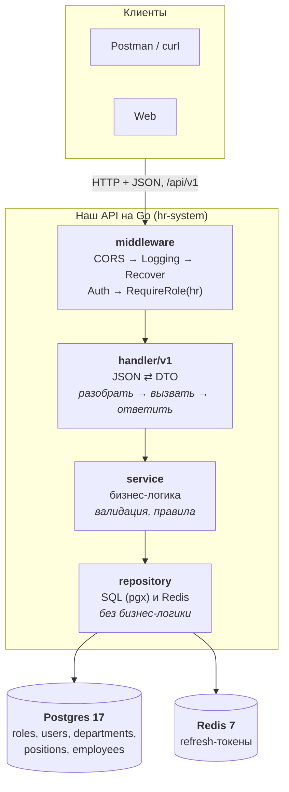
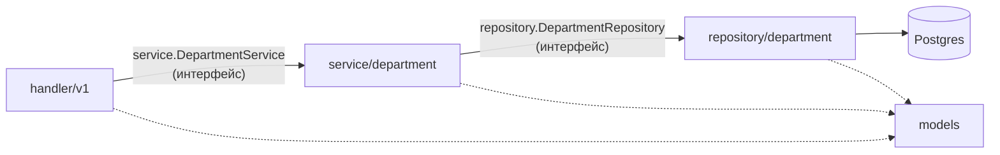
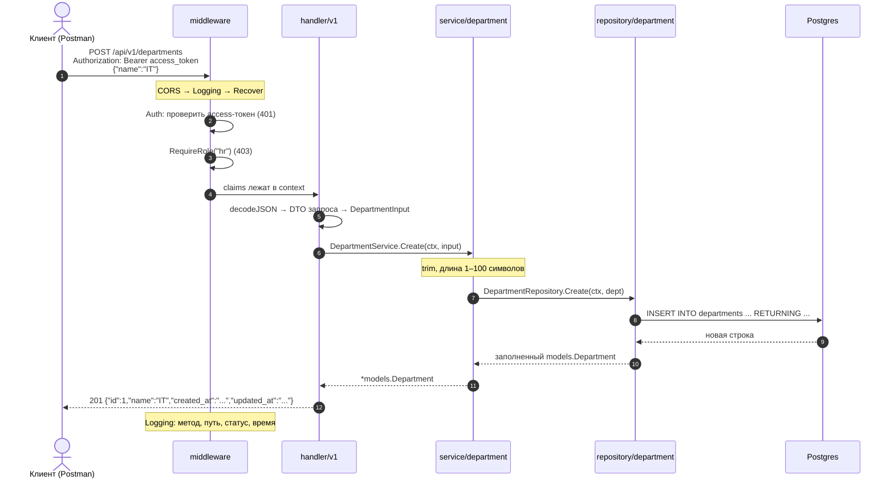
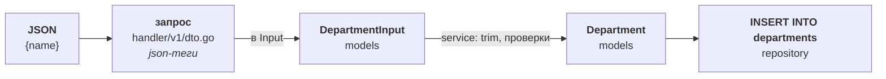
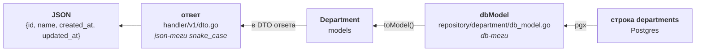
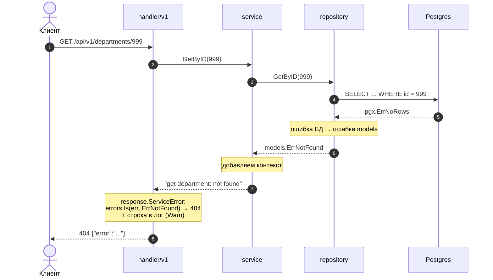
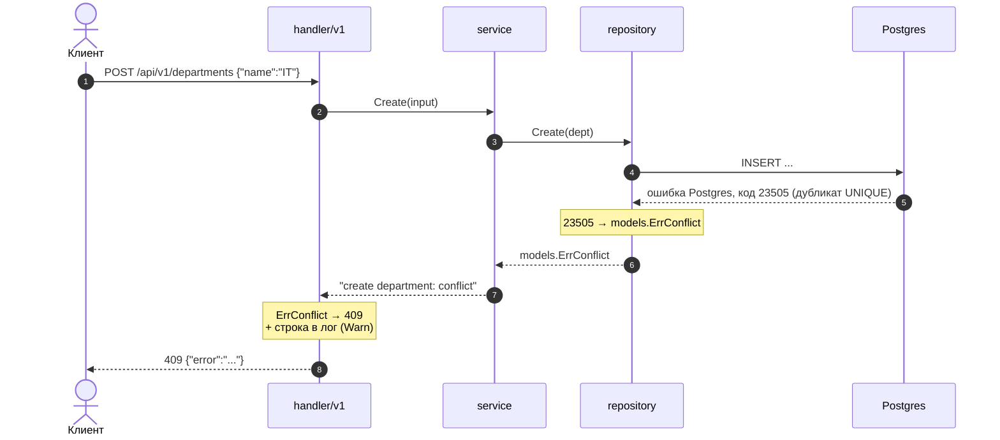

# Как добавить новую фичу

Гайд на сквозном примере: **отделы (departments)**, шаг 4 ТЗ. Тот же порядок повторяется для должностей, сотрудников, зарплат и отпусков.

Код пишем сами. Здесь для каждого слоя: что он делает, какие файлы создать, что внутри (словами), как понять, что готово.

```
POST   /api/v1/departments        создать (201)
GET    /api/v1/departments        список (200, пустой список = [])
GET    /api/v1/departments/{id}   получить (200)
PUT    /api/v1/departments/{id}   изменить (200)
DELETE /api/v1/departments/{id}   удалить (204; 409, если есть сотрудники)
```

Все пять ручек доступны только роли `hr`. Тело запроса: `{"name":"IT"}`.

> Диаграммы в формате Mermaid. GitHub, GitLab и VS Code (с расширением) рисуют их в предпросмотре.

## Принятые решения (из ТЗ)

Эти правила действуют везде в гайде:

- Дубликат (email, имя отдела и т.п.) и связанные записи при удалении: `models.ErrConflict` → HTTP 409. Отдельного `ErrEmailTaken` нет.
- Тип id в Go: `int64`, в Postgres остаётся `SERIAL`.
- Ошибки запросов логируются в одном месте, `internal/handler/response/response.go`: 4xx как Warn, 500 как Error.
- Тексты ошибок короткие, на английском, в формате `{"error":"текст"}` (например `invalid email or password`).
- `requireHR` — локальная переменная в `InitRoutes()`, собранная из `requireAuth` и `RequireRole("hr")`.
- `REDIS_PASSWORD` локально пустой.

## Архитектура

Клиент (Postman, сайт, мобильное приложение) шлёт HTTP-запрос с JSON и получает JSON. Внутри API запрос идёт сверху вниз, ответ возвращается снизу вверх.



`models` на схеме нет: это общие структуры (`Department`, `Employee`) и ошибки (`ErrNotFound`), которыми пользуются все слои.

Для отделов Redis не нужен: он используется только в авторизации (refresh-токены).

## Зоны ответственности слоёв

Аналогия, ресторан:

| Слой | В ресторане | Делает | НЕ делает |
|---|---|---|---|
| `middleware` | охранник | логирует запрос, ловит панику, проверяет токен и роль | бизнес-логику |
| `handler/v1` | официант | разбирает JSON и `{id}`, вызывает сервис, отдаёт JSON, ошибки отдаёт через `response` | решает «можно ли», ходит в БД |
| `service` | повар | валидирует (trim, длины), применяет правила, оборачивает ошибки | HTTP, JSON, SQL, логи |
| `repository` | кладовщик | выполняет SQL, переводит ошибки БД в ошибки `models` | бизнес-условия, логи |
| `models` | меню | структуры и общие ошибки | ввод-вывод, теги `json`/`db` |

Логи ошибок пишет только HTTP-слой: `response.go` (4xx как Warn, 500 как Error) и middleware `Logging`. Сервис и репозиторий не логируют, иначе одна ошибка попадёт в лог несколько раз.

## Кто кого знает



- **Правило зависимостей:** `handler → service → repository → models`. Нижний слой никогда не импортирует верхний: `repository` не знает про `handler`.
- Слои связаны через **интерфейсы**: они лежат в `internal/service/service.go` и `internal/repository/repository.go`.
- Собирает всё вместе `internal/app/app.go`: pool → repositories → services → handler → `http.Server`.
- Импорты идут от имени модуля: `hr-system/internal/models`.

## Жизненный цикл запроса

Пример: `POST /api/v1/departments` с токеном HR.



По шагам:

1. Клиент шлёт запрос.
2. Общие middleware: CORS, Logging (засёк время), Recover (ловит панику → 500).
3. `Auth` читает `Authorization: Bearer`. Нет токена или он плохой → 401.
4. `RequireRole("hr")`: роль `employee` → 403.
5. Ручка разбирает JSON и превращает DTO в структуру из `models`.
6. Сервис проверяет данные и зовёт репозиторий.
7. Репозиторий выполняет SQL.
8. Ответ поднимается обратно, ручка отдаёт JSON, Logging пишет строку.

## Как меняются данные по пути

У каждого слоя своя структура. На границах данные перекладываются.



Обратный путь (чтение):



| Структура | Где лежит | Теги | Зачем |
|---|---|---|---|
| запрос и ответ (DTO) | `handler/v1/dto.go` | `json` | формат API |
| `Department`, `DepartmentInput` | `models/department.go` | нет | с ними работает бизнес-логика |
| `dbModel` | `repository/department/db_model.go` | `db` | формат строки таблицы |

## Как путешествует ошибка

Ошибка создаётся внизу, по пути вверх обрастает контекстом, наверху становится HTTP-статусом.

Пример 1: `GET /api/v1/departments/999`, отдела нет.



Пример 2: `POST` с именем, которое уже есть.



### Кто что переводит

| Где | Что делает с ошибкой |
|---|---|
| repository | `pgx.ErrNoRows` → `ErrNotFound`; код `23505` (дубликат) → `ErrConflict`; на удалении код `23503` (есть связанные записи) → `ErrConflict`; `Delete` без затронутых строк → `ErrNotFound` |
| service | бизнес-отказ (пустое имя, длина) → `ErrInvalidInput` с пояснением; ошибку снизу оборачивает: `fmt.Errorf("...: %w", err)` |
| handler | `response.ServiceError` по `errors.Is` выбирает HTTP-статус и пишет строку в лог |

Таблица `response.ServiceError` из ТЗ:

| Ошибка `models` | HTTP | Лог |
|---|---|---|
| `ErrInvalidInput` | 400 | Warn |
| `ErrInvalidToken`, `ErrInvalidCredentials` | 401 | Warn |
| `ErrForbidden` | 403 | Warn |
| `ErrNotFound` | 404 | Warn |
| `ErrConflict` | 409 | Warn |
| всё остальное | 500 | Error |

Неизвестная ошибка (упала БД, баг) → клиенту 500 без подробностей, в лог идёт вся цепочка. Формат любого ответа с ошибкой: `{"error":"текст"}`, текст короткий, на английском.

Фрагмент для идеи (как репозиторий распознаёт дубликат):

```go
var pgErr *pgconn.PgError
if errors.As(err, &pgErr) && pgErr.Code == "23505" {
	return models.ErrConflict
}
```

## Порядок работы

| № | Что | Файл (путь из ТЗ) |
|---|---|---|
| 1 | Таблица | `migrations/002_departments_positions.sql` |
| 2 | Модели | `internal/models/department.go` |
| 3 | Интерфейс репозитория + поле в `Repositories` | `internal/repository/repository.go` |
| 4 | Репозиторий | `internal/repository/department/repository.go`, `db_model.go` |
| 5 | Интерфейс сервиса + поле в `Services` | `internal/service/service.go` |
| 6 | Сервис | `internal/service/department/service.go`, `create.go`, `get.go`, `list.go`, `update.go`, `delete.go` |
| 7 | DTO и ручки | `internal/handler/v1/dto.go`, `internal/handler/v1/department.go` |
| 8 | Маршруты | `internal/handler/handler.go` (`InitRoutes`) |
| 9 | Сборка | `internal/app/app.go` |
| 10 | Проверка в Postman и документация | `docs/openapi.yaml`, `README.md` |

Идём по порядку. Дальше не двигаемся, пока проверка текущего шага не прошла.

---

## 1. Миграция

**Что делает:** создаёт таблицу.

**Файл:** `migrations/002_departments_positions.sql` (по ТЗ в нём и отделы, и должности, она создаётся на шаге 2).

**Что внутри (словами):** таблица `departments`: `id` SERIAL PK, `name` VARCHAR(100) NOT NULL UNIQUE, `created_at` и `updated_at` TIMESTAMPTZ NOT NULL DEFAULT now(). Готовый SQL лежит в шаге 2 ТЗ.

**Важно:**
- Файлы из `migrations/` выполняются по алфавиту, поэтому номер в начале имени (`001`, `002`, ...).
- Они применяются только при первом создании базы. Изменили или добавили файл → `make infra-reset` (данные удалятся).
- Для следующих фич номера по плану ТЗ: `004` зарплаты, `005` отпуска, `006` история.

**Готово, когда:**
- [ ] `make infra-reset` прошёл без ошибок.
- [ ] `docker exec hr-postgres psql -U hr -d hr-db -c "\dt"` показывает `departments`.

## 2. Модели

**Что делает:** описывает сущность и вход сценария. Не знает ни про БД, ни про HTTP.

**Файлы:** `internal/models/department.go`, `internal/models/errors.go` (уже есть с шага 3).

**Что внутри (словами):**
- `Department`: ID (`int64`), Name, CreatedAt, UpdatedAt.
- `DepartmentInput`: только Name.
- Без тегов `json` и `db`.
- Новые ошибки для отделов не нужны: хватает `ErrNotFound`, `ErrInvalidInput`, `ErrConflict`.

**Готово, когда:**
- [ ] В файле нет импортов `gin`, `net/http` и `pgx`.
- [ ] В структурах нет тегов.
- [ ] `go build ./...` проходит.

## 3. Интерфейс репозитория

**Что делает:** контракт «что можно делать с отделами в хранилище».

**Файл:** `internal/repository/repository.go`.

**Что внутри (словами):** интерфейс `DepartmentRepository` с 5 методами: `Create`, `List`, `GetByID`, `Update`, `Delete`. Плюс поле `Department` в структуре `Repositories` (это набор всех репозиториев, `app.go` собирает его один раз).

Идея сигнатур:

```go
type DepartmentRepository interface {
	Create(ctx context.Context, d *models.Department) error
	GetByID(ctx context.Context, id int64) (*models.Department, error)
	List(ctx context.Context) ([]models.Department, error)
	// Update и Delete по тому же принципу
}
```

**Готово, когда:**
- [ ] Интерфейс и поле в `Repositories` есть.
- [ ] Пакет не импортирует `service` или `handler`.

## 4. Репозиторий

**Что делает:** только SQL. Никаких бизнес-условий.

**Файлы:** `internal/repository/department/repository.go` и `db_model.go`.

**Что внутри (словами):**
- `db_model.go`: структура `dbModel` с тегами `db:"..."` и метод `toModel()`, который превращает её в `models.Department`.
- `repository.go`: структура с `*pgxpool.Pool`, конструктор `NewRepository(db *pgxpool.Pool)`, 5 методов с SQL.
- Имена колонок в `SELECT` совпадают с тегами `db`.
- `Create` и `Update` возвращают через `RETURNING` то, что сгенерировала БД (`id`, даты).
- `Update` должен обновлять `updated_at`.
- Перевод ошибок:
  - `pgx.ErrNoRows` → `models.ErrNotFound`;
  - код `23505` → `models.ErrConflict`;
  - на `Delete` код `23503` → `models.ErrConflict`, а если не затронуто ни одной строки → `models.ErrNotFound`.
- Остальные ошибки оборачиваются: `fmt.Errorf("select department by id: %w", err)`.
- Не писать условий вроде «сначала проверим, есть ли сотрудники». Это решает БД через `ON DELETE RESTRICT`, а репозиторий только переводит код ошибки.
- Не логировать.

**Готово, когда:**
- [ ] В пакете нет `log`/`slog` и нет проверок бизнес-правил.
- [ ] Каждая ошибка БД либо переведена в `models.Err...`, либо обёрнута через `%w`.
- [ ] `go build ./...` проходит.

## 5. Интерфейс сервиса

**Что делает:** контракт «что умеет бизнес-логика отделов».

**Файл:** `internal/service/service.go`.

**Что внутри (словами):** интерфейс `DepartmentService` и поле `Department` в структуре `Services`. Методы повторяют репозиторий, но на входе `DepartmentInput` (а не готовая `Department`), потому что сервис сам собирает сущность.

```go
type DepartmentService interface {
	Create(ctx context.Context, in models.DepartmentInput) (*models.Department, error)
	GetByID(ctx context.Context, id int64) (*models.Department, error)
	List(ctx context.Context) ([]models.Department, error)
	// Update и Delete по тому же принципу
}
```

**Готово, когда:**
- [ ] Интерфейс и поле в `Services` есть.
- [ ] В интерфейсе нет типов из `gin` и `net/http`.

## 6. Сервис

**Что делает:** проверяет данные, вызывает репозиторий, оборачивает ошибки.

**Файлы:** `internal/service/department/`: `service.go` + по файлу на операцию (`create.go`, `get.go`, `list.go`, `update.go`, `delete.go`).

**Что внутри (словами):**
- `service.go`: структура с полем-интерфейсом `repository.DepartmentRepository`, конструктор `NewService(...)` и строка `var _ service.DepartmentService = (*Service)(nil)` (проверка, что интерфейс реализован).
- `create.go` и `update.go`: `strings.TrimSpace`, длина имени 1–100 символов через `utf8.RuneCountInString` (кириллица считается по символам, а не по байтам). Не прошло → `fmt.Errorf("%w: ...", models.ErrInvalidInput)`.
- `get.go`, `list.go`, `delete.go`: вызов репозитория и оборачивание ошибки.
- `list.go`: пустой список должен стать `[]`, а не `null` в JSON (по ТЗ). Где именно создать пустой срез, решай сам.
- Сервис зависит от интерфейса, а не от Postgres: в тестах (шаг 9 ТЗ) вместо БД подставляется мок.
- Никаких `http.*`, JSON, SQL, логов.

Идея оборачивания ошибки:

```go
if err != nil {
	return nil, fmt.Errorf("get department: %w", err)
}
```

**Готово, когда:**
- [ ] В пакете нет импортов `gin`, `net/http`, `pgx`.
- [ ] Каждая ошибка снизу обёрнута через `%w`.
- [ ] Валидация есть и в `Create`, и в `Update`.
- [ ] `go build ./...` проходит.

## 7. DTO и ручки

**Что делает:** превращает HTTP в вызов сервиса и обратно.

**Файлы:** `internal/handler/v1/dto.go` (общий файл всех DTO), `internal/handler/v1/department.go`. Помощники `decodeJSON` и `parseID` лежат в `internal/handler/v1/request.go`, ответы строятся через `internal/handler/response/response.go`.

**Что внутри (словами):**
- DTO запроса: структура с полем `name` (тег `json:"name"`) и преобразование в `models.DepartmentInput`.
- DTO ответа: `id`, `name`, `created_at`, `updated_at` (snake_case) и преобразование из `*models.Department`.
- 5 методов общего `Handler`: имя включает сущность (`CreateDepartment`, `GetDepartment`, `ListDepartments`, `UpdateDepartment`, `DeleteDepartment`).
- Каждая ручка делает три шага: **разобрать запрос → вызвать сервис → ответить**.
- Ошибка сервиса всегда идёт в `response.ServiceError`. Статусы успеха: создание 201, чтение и изменение 200, удаление 204 (без тела).
- Неверный `{id}` (например `/abc`) → 400 из `parseID`.
- Если в ручке появилось бизнес-правило, место ему в сервисе.

Идея сигнатуры ручки:

```go
func (h *Handler) GetDepartment(c *gin.Context) {
	// 1) id, ok := parseID(c)  2) h.services.Department.Get(c.Request.Context(), id)
	// 3) response.JSON(c, ...) или response.ServiceError(c, err)
}
```

**Готово, когда:**
- [ ] В ручках нет `if` про бизнес-правила.
- [ ] Ответ содержит только поля из ТЗ (`id`, `name`, `created_at`, `updated_at`).
- [ ] `go build ./...` проходит.

## 8. Маршруты

**Что делает:** связывает метод и путь с ручкой и ставит защиту.

**Файл:** `internal/handler/handler.go`, метод `InitRoutes()`.

**Что внутри (словами):**
- В начале `InitRoutes()` создать локальную переменную `requireHR`: цепочка из `requireAuth` и `RequireRole("hr")`.
- 5 маршрутов вида `hr.POST("/departments", h.v1.CreateDepartment)`, `hr.GET("/departments/:id", ...)` и т.д. в группе `hr := api.Group("", requireAuth, requireHR)` (Gin).
- Общие middleware подключены один раз через `router.Use(...)`: RequestID → CORS → Logging → Recover.
- Значение `:id` читается в ручке через `c.Param("id")` (внутри `parseID`).

```go
hr := api.Group("", requireAuth, requireHR)
hr.POST("/departments", h.v1.CreateDepartment)
```

**Готово, когда:**
- [ ] 5 маршрутов зарегистрированы.
- [ ] Запрос без токена даёт 401 (не 404 и не 200).

## 9. Сборка в app

**Что делает:** создаёт объекты и передаёт зависимости.

**Файл:** `internal/app/app.go`.

**Что внутри (словами):** цепочка всегда одна: `Repositories → Services → Handler → InitRoutes()`. Для отделов добавь:
- строку в `Repositories` (репозиторий отделов получает `*pgxpool.Pool`);
- строку в `Services` (сервис отделов получает репозиторий).

Пакеты repository и service называются одинаково (`department`), поэтому при импорте нужны алиасы:

```go
import (
	departmentrepo "hr-system/internal/repository/department"
	departmentservice "hr-system/internal/service/department"
)
```

**Готово, когда:**
- [ ] `go build ./... && go vet ./...` проходит без ошибок.
- [ ] `make run` стартует, в `app.log` есть строка `server started`.

## 10. Проверка в Postman

Переменные коллекции `hr-system`: `baseUrl = http://localhost:8080`, `token` (вставляется вручную: скрипты переменные не пишут). В защищённых запросах: Authorization → Bearer `{{token}}`.

Сначала получи токен: `POST {{baseUrl}}/api/v1/auth/login`, тело `{"email":"hr@company.local","password":"<пароль, который ты ввёл в go run ./cmd/seed>"}`.

| № | Запрос | Ожидание |
|---|---|---|
| 1 | POST `/api/v1/departments` `{"name":"IT"}` | **201** |
| 2 | то же имя ещё раз | **409** |
| 3 | `{"name":""}` | **400** |
| 4 | GET `/api/v1/departments` | **200** |
| 5 | GET `/api/v1/departments/999` | **404** |
| 6 | GET `/api/v1/departments/abc` | **400** |
| 7 | PUT `/api/v1/departments/1` с новым именем | **200** |
| 8 | DELETE `/api/v1/departments/1` | **204**, повторный: **404** |
| 9 | любой запрос без токена | **401** |
| 10 | токеном `employee` (после шага 6 ТЗ) | **403** |
| 11 | удалить отдел, в котором есть сотрудники (после шага 6 ТЗ) | **409** |

В каждом ответе с ошибкой тело вида `{"error":"текст"}`, а в `app.log` строка: Warn для 4xx, Error для 500.

**Готово, когда:** пункты 1–9 дают ожидаемые коды (пункты 10–11 проверяются после шага 6).

Когда фича целиком готова, обнови `docs/openapi.yaml` (пути, схемы, коды 400/401/403/404/409) и `README.md` (если в нём перечислены ручки).

---

## Если нужна настройка из конфига

В ТЗ конфиг описан так: структура `Config` с тегами `envconfig`, `Load()` читает `.env` через `godotenv` (файл `internal/config/config.go`). Для новой настройки:
1. добавить поле в структуру в `config.go`;
2. добавить переменную в `.env.example` и в `.env`;
3. передать значение в конструктор сервиса в `app.go`.

## Если нужна новая ошибка

1. Добавить `Err...` в `internal/models/errors.go`.
2. Вернуть её из сервиса.
3. Добавить `case` в `response.ServiceError` с нужным HTTP-статусом. Без этого шага клиент получит 500.

## Чек-лист фичи целиком

- [ ] Миграция с номером, `make infra-reset`.
- [ ] `models`: сущность и `...Input` без тегов, id типа `int64`.
- [ ] `repository.go`: интерфейс и поле в `Repositories`; пакет сущности с `dbModel`, только SQL, ошибки БД переведены (`ErrNotFound`, `ErrConflict`), без логов.
- [ ] `service.go`: интерфейс и поле в `Services`; `var _ service.XxxService = (*Service)(nil)`; ошибки обёрнуты через `%w`; нет HTTP, SQL и логов.
- [ ] Handler: DTO с json-тегами, ручка «разобрать → сервис → ответить», ошибки через `response`.
- [ ] Маршруты в `InitRoutes` через `requireHR`.
- [ ] Сборка в `app.go`: строка в `Repositories` и в `Services`.
- [ ] `go build ./... && go vet ./...`.
- [ ] Все коды из таблицы Postman совпали.
- [ ] `docs/openapi.yaml` и `README.md` обновлены.
