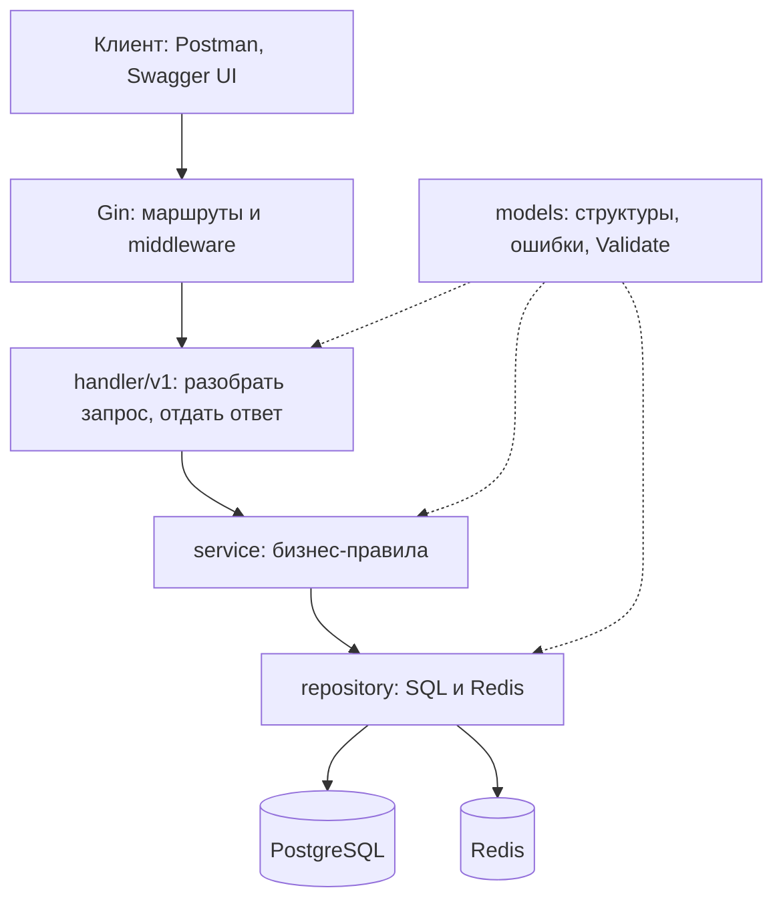

# Архитектура hr-system

REST API учёта сотрудников на Go: Gin, PostgreSQL, Redis, JWT. Код разделён на слои, и каждый слой знает только о тех, кто ниже.

## Слои и правило зависимостей

Импортировать можно только вниз по стрелкам. `models` знают все, он не знает никого.

| Пакет | Что делает | Чего там быть не должно |
|---|---|---|
| `cmd/api`, `cmd/seed` | точки входа | бизнес-логики |
| `internal/app` | собирает зависимости вручную (DI), запускает сервер, плавно останавливает | SQL, правил |
| `internal/config` | читает env-файл и переменные окружения | логики |
| `internal/handler` (+ `v1`, `middleware`, `response`) | маршруты, разбор запроса, формат ответа | SQL, бизнес-проверок, своего `slog` |
| `internal/service/*` | правила: проверка данных, права, порядок операций, хэш пароля, токены | `gin`, `net/http`, `pgx`, `go-redis` |
| `internal/repository/*` | SQL и Redis, перевод ошибок БД в `models.Err...` | правил, `gin` |
| `internal/models` | структуры, ошибки, `Validate()` | ввода-вывода, тегов `json` и `db` |
| `pkg/*` | `logger`, `postgres`, `redis`: не зависят от `internal` | |

`gin` импортируется только в `handler` и в `app.go`. `pgx` и `go-redis` только в `repository`, `pkg` и `app.go`.

## Как идёт запрос

`POST /api/v1/employees` (создание сотрудника):

1. `RequestID` создаёт id запроса, кладёт его в контекст и в заголовок `X-Request-ID`.
2. `CORS`, `Logging`, `Recover` выполняются для каждого запроса.
3. `Auth` проверяет `Authorization: Bearer ...` и кладёт id и роль в контекст, `RequireRole("hr")` пропускает только HR.
4. `v1.CreateEmployee` читает JSON (лимит 1 МБ, лишние поля запрещены), разбирает дату и вызывает сервис.
5. `service/employee.Create`: `Validate()` → отдел и должность существуют → роль `employee` → bcrypt → репозиторий.
6. `repository/employee.Create` в одной транзакции создаёт `users`, `employees` и первую строку истории.
7. Сервис возвращает результат или ошибку, `response.JSON` / `response.ServiceError` формируют ответ.

## Ошибки

Репозиторий переводит ошибки БД в общие ошибки проекта (`internal/repository/dberr`), сервис оборачивает их через `fmt.Errorf("...: %w", err)`, а `response.ServiceError` превращает в HTTP-код:

| Ошибка | Код | Когда |
|---|---|---|
| `ErrInvalidInput` | 400 | не прошла проверка данных |
| `ErrInvalidToken`, `ErrInvalidCredentials` | 401 | плохой токен, неверный email или пароль |
| `ErrForbidden` | 403 | нет прав |
| `ErrNotFound` | 404 | записи нет |
| `ErrConflict` | 409 | дубликат, связанные записи, пересечение дат, неподходящее состояние |
| любая другая | 500 | наружу уходит `internal server error`, подробности только в логе |

Ответ всегда `{"error":"текст"}`. Все тексты в коде на английском: клиентские (для них используется `models.Message`, он отрезает служебные префиксы) и внутренние (обёртки ошибок вида `create department: %w`, строки лога).

## Логи

Ошибки запросов пишет только `handler/response`: 4xx как `Warn`, 5xx как `Error`. Остальные слои возвращают ошибку и ничего не логируют. Каждая строка, записанная с контекстом запроса, получает `request_id`, поэтому по id из ответа находят причину в логе. В `local` лог пишется в `app.log` текстом, в остальных окружениях в stdout JSON-ом.

## Авторизация

- **Access-токен**: JWT HS256 на 15 минут (`sub`, `role`, `type=access`). Проверяется без обращения к БД.
- **Refresh-токен**: 32 случайных байта, живёт 30 дней. В Redis хранится только его SHA-256: `refresh:<хэш>` со значением id пользователя и TTL, а `refresh_user:<id>` это множество хэшей пользователя (чтобы отозвать все сразу).
- Обновление использует `GETDEL`, поэтому старый refresh-токен одноразовый. Увольнение отзывает все токены сотрудника и блокирует вход (`users.is_active = false`).
- Секрет подписи берётся из `JWT_SECRET` (не короче 32 байт, иначе приложение не запустится).

## Транзакции и конкурентность

| Операция | Что делает в транзакции |
|---|---|
| создание сотрудника | `users` + `employees` + первая запись истории |
| изменение сотрудника | блокировка строки, обновление, при смене отдела или должности закрытие и открытие записи истории |
| увольнение | статус и дата, `users.is_active`, закрытие записи истории |
| заявка на отпуск | `pg_advisory_xact_lock` по сотруднику, затем вставка только если нет пересечения (две параллельные заявки не пройдут обе) |

## Конфигурация и секреты

Настройки читаются из переменных окружения (`envconfig`). Файл со значениями лежит вне проекта, путь к нему в переменной `ENV_FILE`; если её нет, берётся `.env` в текущей папке. В репозитории только шаблон `.env.example`. Пароли, `JWT_SECRET` и хэши нельзя писать в логи, ответы, README и чаты.

## Тесты

- **service**: табличные тесты с моками репозиториев (`internal/repository/mocks`, mockery).
- **handler**: настоящий Gin (`httptest`) с моками сервисов (`internal/service/mocks`): маршруты, права, коды ответов, формат ошибок.
- **models**, **dberr**, **logger**, `escapeLike`: обычные тесты функций.
- Моки генерирует `make mocks` по `.mockery.yaml`; после любого изменения интерфейсов в `repository.go` или `service.go` их нужно перегенерировать.
- `make check` запускает сборку, `go vet` и тесты. SQL проверяется вручную по сценариям из «Проверка:» в ТЗ (Postman) на настоящих Postgres и Redis.

## Как добавить фичу

См. `docs/adding-feature.md`: порядок слоёв на примере отделов (миграция → models → интерфейсы → repository → service → handler → маршруты → app.go → openapi → тесты).
