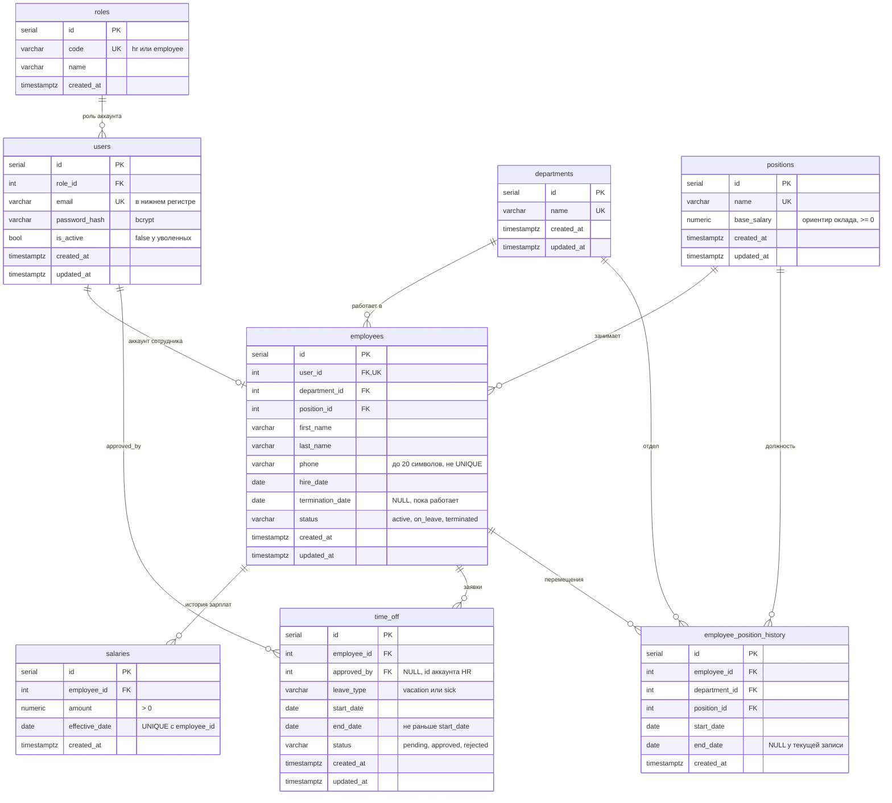

# Схема базы данных

8 таблиц. Миграции лежат в `migrations/` и применяются Docker-ом при первом создании базы (`make infra-reset` пересоздаёт её с нуля). Refresh-токены в БД не хранятся, они в Redis.

## Правила, которые держит база

| Правило | Как |
|---|---|
| email уникален и хранится в нижнем регистре | `UNIQUE` и `CHECK (email = lower(email))` |
| один аккаунт это один сотрудник | `UNIQUE (user_id)` в `employees` |
| нельзя удалить отдел или должность, на которых есть сотрудники | `ON DELETE RESTRICT` (приложение отвечает 409) |
| уволенного не удаляем, а помечаем | `status = 'terminated'`, `termination_date`, `users.is_active = false` |
| дата увольнения не раньше даты приёма | `CHECK` в `employees` |
| у сотрудника не больше одной зарплаты на дату | `UNIQUE (employee_id, effective_date)` |
| текущая зарплата | последняя запись с `effective_date <= сегодня` |
| конец отпуска не раньше начала | `CHECK (end_date >= start_date)` |
| при удалении сотрудника уходят его зарплаты, заявки и история | `ON DELETE CASCADE` (сам сотрудник не удаляется, это защита целостности) |

## Индексы

`idx_users_role_id`, `idx_employees_department_id`, `idx_employees_position_id`, `idx_employees_status`, `idx_employees_name (last_name, first_name)`, `idx_salaries_employee_id`, `idx_time_off_employee_id`, `idx_time_off_status`, `idx_history_employee_id`. Первичные ключи и `UNIQUE` индексируются автоматически.
